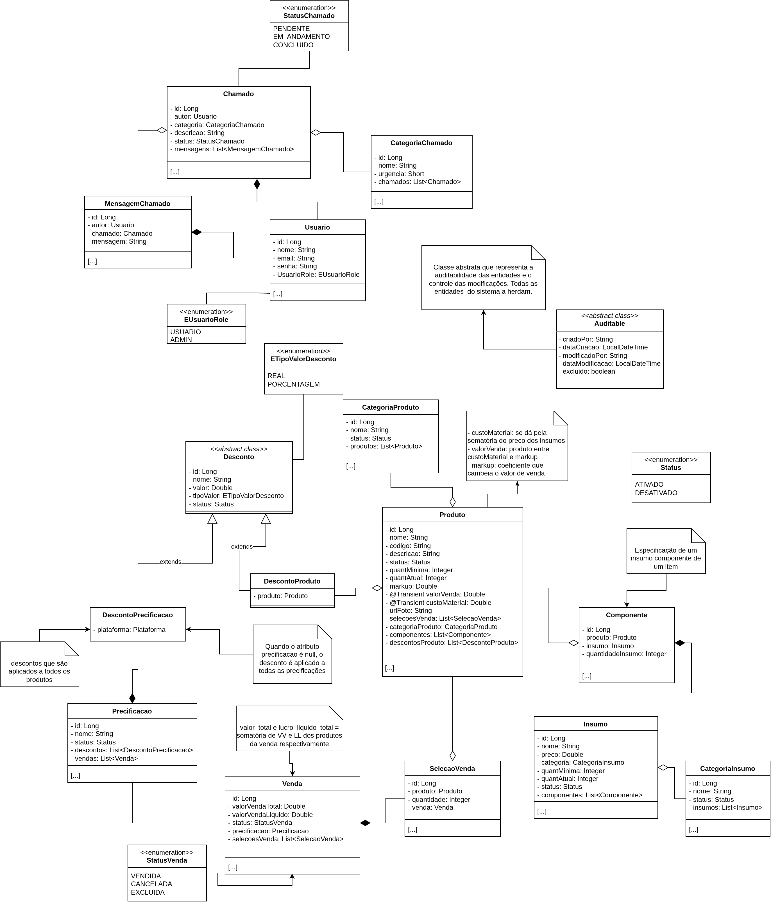

# Sistema ERP Full-Stack

Projeto de sistema de controle de estoque de produtos e insumos, além de controle de vendas com gráficos e análise de dados.

## Detalhes do projeto
### Problema
Operações que dependem de controles manuais enfrentam falta de rastreabilidade nas movimentações de estoque, dificuldade no cálculo de custo e markup de produtos compostos por múltiplos insumos e lentidão na comunicação de demandas operacionais.
### Solução
Este template oferece uma base **Full-Stack (Spring Boot + React PWA)** pronta para produção que centraliza a gestão de inventário e o atendimento interno (Help Desk) em uma única plataforma:

* **Gestão de Composição e Precificação:** Cálculo automatizado de custos a partir de insumos vinculados e controle de estoque mínimo.
* **Integridade e Auditoria:** Histórico completo de alterações rastreado via **Hibernate Envers** e preservação de dados com **Soft Delete**.
* **Performance de Banco:** Consultas otimizadas contra o problema de **N+1**.
* **Experiência Mobile Nativa (PWA):** Instalação direta em dispositivos móveis em modo *standalone* sem necessidade de lojas de aplicativos.

## 🚀 Como Rodar o Projeto Localmente

Siga as instruções abaixo para configurar e executar a aplicação na sua máquina.

### 📋 Pré-requisitos

Certifique-se de ter as seguintes ferramentas instaladas:
* **Java JDK 17+** (ou a versão configurada no `pom.xml`)
* **Maven 3.8+** (ou utilize o wrapper `./mvnw` incluso no projeto)
* **Node.js 18+** e **Yarn**
* **Banco de Dados:** PostgreSQL (ou perfil local com H2)

---

### 1. Clonar e Configurar as Variáveis de Ambiente (`.env`)

1. Clone o repositório e acesse a pasta raiz:
   ```bash
   git clone https://github.com
   cd SEU_REPOSITORIO
   ```

2. **Configurar Variáveis de ambiente:** Crie o arquivo `.env` a partir do modelo:
   ```bash
   cp .env.example .env
   ```
   Preencha com as suas credenciais locais:
   ```env
    H2_DBNAME=no
    H2_PASSWORD=
    H2_USERNAME=

    JWT_SECRET_DEV=

    SPRING_PROFILES_ACTIVE=dev

    VITE_API_URL=http://localhost:8080
   ```

---

### 2. Instalar Dependências e Executar
Estando na **raiz do projeto**, Instale todas as dependências de todos os pacotes do projeto com o comando abaixo:

```bash
yarn install
```

#### ⚡ Opção A: Execução Unificada (Recomendado)
Na **raiz do projeto**, suba o Front-end e o Back-end simultaneamente com um único comando:

```bash
yarn web:api
```
*O Front-end estará acessível em `http://localhost:5173` e a API em `http://localhost:8080`.*

---

#### 🛠️ Opção B: Execução Separada (Manual)
Caso prefira rodar os serviços em terminais independentes:

* **Terminal 1 (Back-end):**
  ```bash
  cd api
  ./mvnw spring-boot:run
  ```
* **Terminal 2 (Front-end):**
  ```bash
  cd web
  yarn dev
  ```

---

## Tecnologias, Metodologias e Arquitetura
### Tecnologias Utilizadas
<p align="center">
  <a href="https://skillicons.dev">
    
  </a>
</p>
<p align="center">
  <a href="https://skillicons.dev">
    
  </a>
</p>

Abaixo as especificações de metodologias, arquiteturas e práticas adotadas para o desenvolvimento além das tecnologias.


A seguir as tecnologias que serão utilizadas para desenvolver o projeto e a justificativa do uso de cada uma:

**Banco de dados:**
- PostgreSQL: Solução leve e moderna usada pelo mercado de banco relacional.

**API REST (Back-End):**
- Spring Boot: Estruturação definida da API e organização do código, familiaridade com ecossistema.


Linguagens e referências: Java, Spring Data JPA.

**Front-End:**
- React.js (Web): Experiência prévia com o a biblioteca; foco na experiência do usuário.

Linguagens e referências: HTML, CSS, Javascript, Typescript, Node.js, Vite.


### Diagramas

<table border="1">
    <thead>
        <tr>
            <th>Nome</th>
            <th>Diagrama</th>
        </tr>
    </thead>
    <tbody>
    <tr>
        <td>Caso de Uso</th>
        <td></th>
    </tr>
    <tr>
        <td>Diagrama de Classes</th>
        <td></th>
    </tr>
    </tbody>
</table>